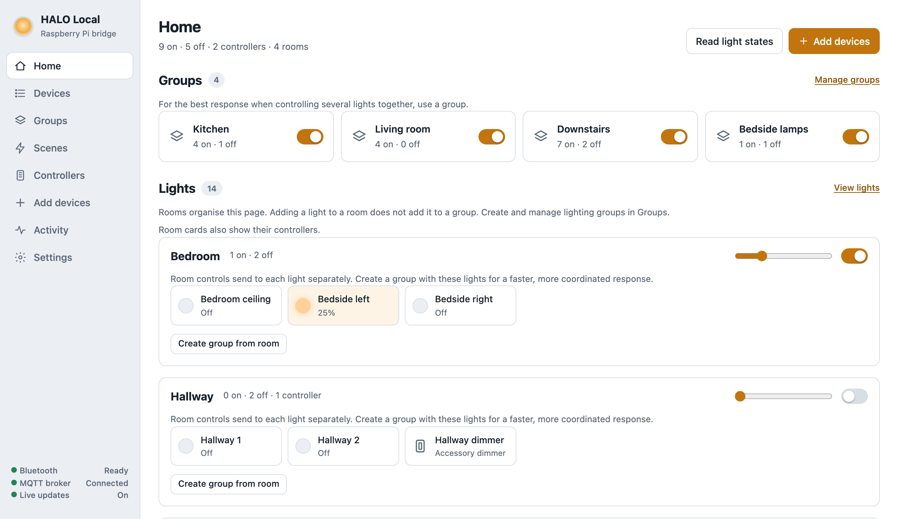
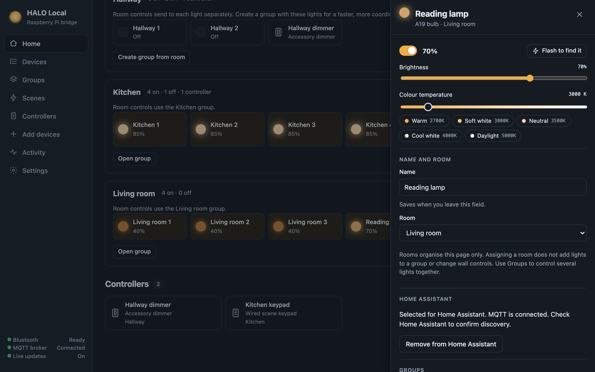
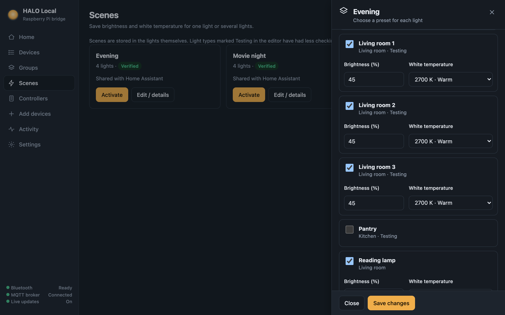
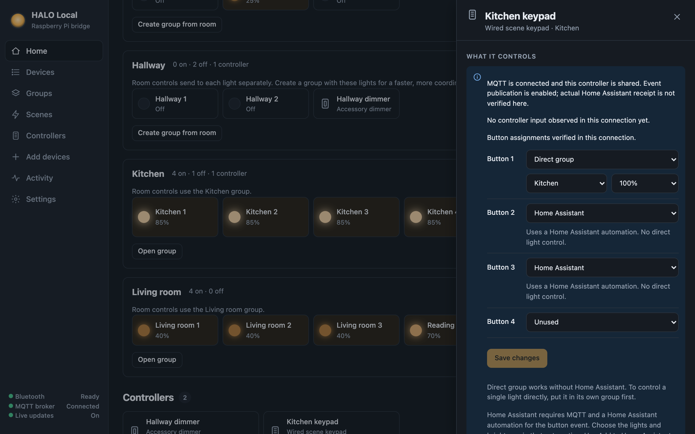
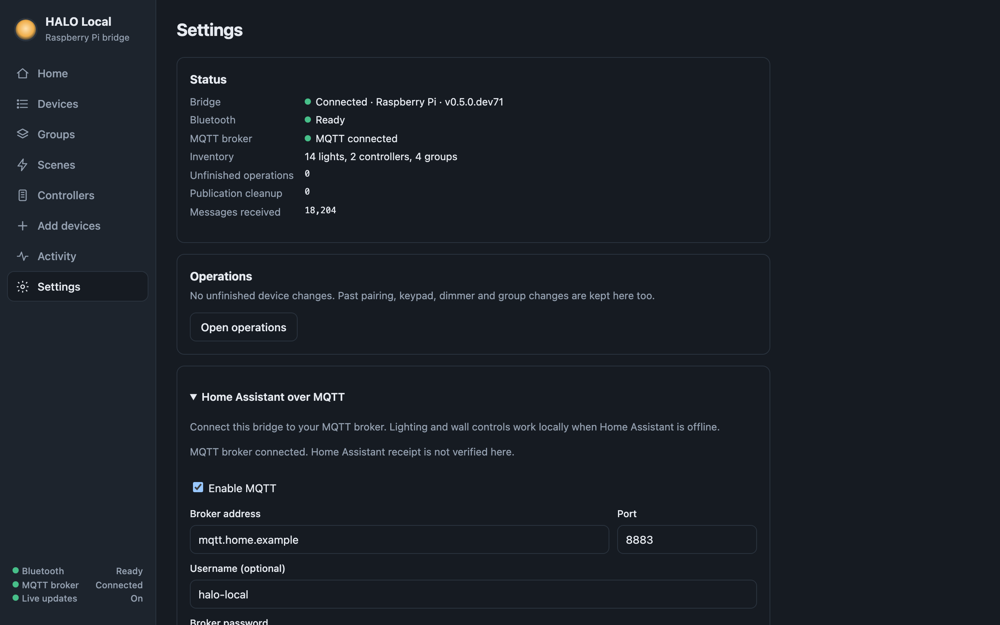
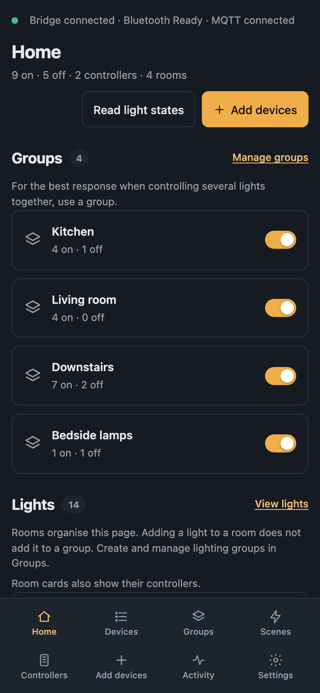
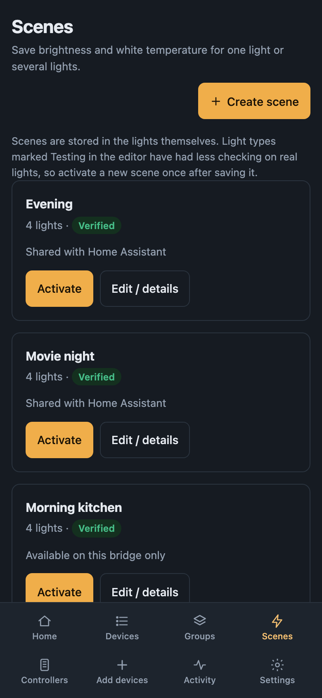
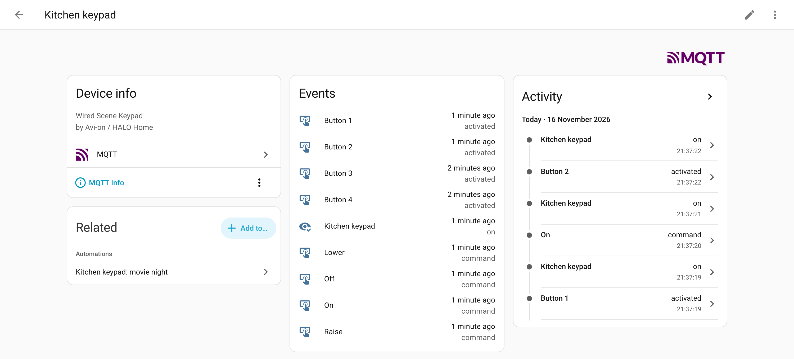
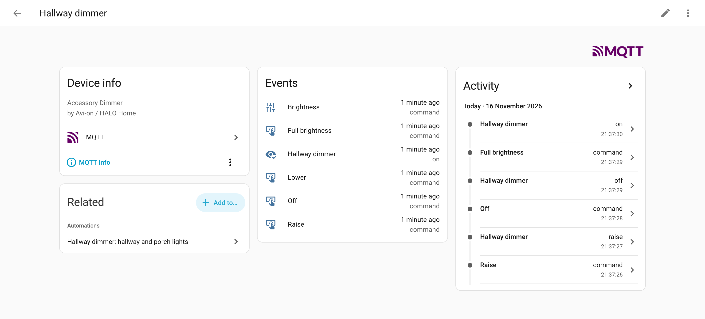

<h1 align="center">HALO Local</h1>

<p align="center">
  <b>Control your HALO Home / Avi-on lights from a Raspberry Pi on your own network.</b><br>
  A local lighting bridge for Raspberry Pi and Linux, with a web page for lights, rooms,
  groups, scenes and controllers, and optional Home Assistant over MQTT.
</p>

<p align="center">
  
  
  
  
  <a href="https://github.com/tvanbave/halo-local-dev/actions/workflows/ci.yml"></a>
</p>

<p align="center">
  <picture>
    <source media="(prefers-color-scheme: dark)" srcset="docs/images/home-desktop-dark.png">
    <source media="(prefers-color-scheme: light)" srcset="docs/images/home-desktop-light.png">
    
  </picture>
</p>

<p align="center">
  <a href="docs/INSTALL.md"><b>Install on a Raspberry Pi</b></a> ·
  <a href="https://github.com/tvanbave/halo-local-dev/releases/tag/v0.5.0-dev77">Download dev77 for 64-bit Raspberry Pi OS</a> ·
  <a href="#what-works-today">What works today</a> ·
  <a href="#hardware-status">Hardware status</a> ·
  <a href="docs/SETUP.md">Setup reference</a> ·
  <a href="docs/SCENES.md">Scene guide</a> ·
  <a href="docs/BACKUP.md">Backup & restore</a>
</p>

> [!IMPORTANT]
> **Development build: 0.5.0.dev77.** This build is for experienced testers, not
> a one-click replacement for the app. Full hardware parity and unattended recovery
> are still being tested; read [Hardware status](#hardware-status) before you rely on it.
> HALO Local is not an official Cooper Lighting or Avi-on product, and it is not
> affiliated with or endorsed by either company.

## Why HALO Local

- **Your lights, on your network.** Normal lighting control and native controller
  assignments work without a vendor cloud login.
- **Keep the setup you already have.** On a new installation, cloud import brings in
  an existing HALO Home / Avi-on network key, devices and groups for local control,
  without re-pairing.
- **One page for the whole house.** Name lights, sort them into rooms, and control
  lights and programmed groups: power, brightness and colour temperature where
  supported. The same page works on a desktop and a phone. Groups appear first on
  Home and are recommended for the best response when controlling several lights
  together. Rooms organise the page only: assigning a room does not create a group
  or add lights to one. Create and manage lighting groups separately in **Groups**.
  Room controls use a group when its members exactly match the room's lights;
  otherwise they send commands to each light separately.
  **Create group from room** prefills the name and preselects its lights for review.
  Verified group setup supports RL4 lights and A19 bulbs, including mixed groups.
- **Scenes stored in the lights.** Save brightness and white temperature for one or
  several lights. A verified scene activates with one native broadcast, however many
  lights it includes.
- **Home Assistant when you want it.** Connect your existing MQTT broker and share
  only the devices, groups and scenes you choose. No broker is needed to start or to
  use native lighting control.
- **Wall controls that start automations.** A keypad button or an Accessory Dimmer
  can switch HALO lights directly over Bluetooth, or be handed to **Home Assistant**.
  There each press is an event that can trigger any automation: HALO lights, lights
  from other brands, or anything else Home Assistant controls.
- **Keep a full backup.** Download a full `.halobackup` in Settings,
  then review it on this bridge or an empty replacement Pi without re-pairing lights.
  The workflow is offline-tested; physical restore acceptance is pending. Read the
  [backup guide](docs/BACKUP.md), including the limits of older backups.
- **Careful with your mesh.** Uncertain writes are never retried by refreshes or
  reconnects. Incomplete operations wait for you to review them.
  During a Bluetooth reconnect, the page keeps previous readings marked **Last known**
  until each light replies again. These readings do not confirm a command or make a
  light available to Home Assistant; a bridge restart starts with no cached readings.
  At startup the bridge requests brightness and white temperature across the mesh.
  Lights appear as they answer. It then checks individual lights for any missing readings. With automatic
  checks enabled, it shows **Waiting for next check…** after a missed reply.
  Three unanswered power checks on the same connection flag that light for attention.
  A power or brightness report clears the warning. The Bluetooth indicator tracks
  the Pi’s connection to its mesh relay.

## A closer look

<table>
  <tr>
    <td width="50%" valign="top">
      
      <p><b>Every light, in detail.</b> Power, brightness and colour temperature,
      a flash to find it, its name and room, and whether Home Assistant sees it.</p>
    </td>
    <td width="50%" valign="top">
      
      <p><b>Scenes, light by light.</b> Set brightness and white temperature for several
      lights together, then adjust individual lights before saving.</p>
    </td>
  </tr>
  <tr>
    <td width="50%" valign="top">
      
      <p><b>Every button, your choice.</b> Point a keypad button at a lighting group,
      hand it to Home Assistant to trigger an automation, or leave it unused.</p>
    </td>
    <td width="50%" valign="top">
      
      <p><b>Home Assistant over MQTT.</b> Test and save your broker in Settings, with
      certificate-verified TLS by default. Saved passwords are never shown.</p>
    </td>
  </tr>
  <tr>
    <td colspan="2" align="center">
      
      
      <p><b>At home on your phone.</b> The same page adapts to a phone, with
      navigation at your thumb.</p>
    </td>
  </tr>
</table>

<sub>Screenshots show an invented home served with synthetic data, not a real installation.</sub>

## Get started

**New to this? Follow [Install on a fresh Raspberry Pi](docs/INSTALL.md).** It
goes step by step from a blank SD card to the page in your browser, and covers
updating, backing up and common problems.

**Recommended network setup: wired Ethernet with the Pi's Wi-Fi disabled.**
Operation over Wi-Fi has not been tested. Keep Bluetooth enabled for the lights.

If the Pi already runs 64-bit Raspberry Pi OS with Docker Compose v2.17 or newer
and its normal Bluetooth service:

```sh
sudo groupadd --gid 65532 halo-local
sudo useradd --uid 65532 --gid 65532 --no-create-home --shell /usr/sbin/nologin halo-local
git clone https://github.com/tvanbave/halo-local-dev.git halo-local
cd halo-local
docker compose up -d --build
docker compose logs bridge
```

The first two lines create the unprivileged user the bridge runs as. The Pi's
system message bus refuses a user ID that does not exist on the Pi.

Then:

1. Open the URL printed in the logs. Browser login is off by default; optional
   password protection is described in [Setup](docs/SETUP.md#optional-browser-login).
2. Choose **Start a new network** to pair devices, **Import existing lights** for
   a HALO Home or Avi-on setup, or **Restore a backup** to use a saved bridge network.
3. Optionally, connect your existing Home Assistant MQTT broker in **Settings**.

The image includes Python and all application dependencies. Compose creates the
persistent data volume, selects the Pi's LAN address and starts the local
UI. No JSON configuration, mesh keys or directory permissions need to be prepared
by hand. Docker, working host Bluetooth drivers/firmware and the host system bus
remain prerequisites.

[Setup](docs/SETUP.md) is the reference: both Bluetooth modes, the optional `.env`
shortcut, switching providers and troubleshooting. It also describes running
Bluetooth inside the stack on a dedicated Pi (`compose.bluetooth.yaml`); bundled
mode installs BlueZ and private D-Bus in its image, and has not yet been accepted
on real hardware.

> [!WARNING]
> These commands are for a **new installation**. An existing bridge must keep its
> complete configuration, mesh key and database; do not use new-mesh setup to
> migrate it. Existing Pi installations are never overwritten by setup. Setup and
> bundled Bluetooth are covered by offline tests. A fresh Pi 3B has built, started
> healthy and updated successfully using host Bluetooth. Browser setup and pairing
> on that installation, and bundled-Bluetooth hardware acceptance, remain outstanding.

## What works today

| Area | What you can do |
| --- | --- |
| Adding devices | Discover and commission supported lights, name them and organise rooms. |
| Lights and groups | Control individual lights and programmed groups: power, brightness and colour temperature where supported, including a 4000 K preset. |
| Scenes | Create, edit, activate and remove verified native scenes for one or several lights; optionally share them with Home Assistant over MQTT. |
| Controllers | Set each keypad button, or an Accessory Dimmer, to control a HALO lighting group directly over Bluetooth or to send its presses to Home Assistant as events for your automations. |
| Home Assistant | Configure MQTT in **Settings** and share selected devices and groups. |
| Existing networks | On a new installation, import an existing HALO Home / Avi-on network key, devices and groups. Later syncs review compatible inventory updates on that same network. |
| Removal | Remove lights and controllers with dependency review and verification; cloud-imported lights also require physical confirmation. Remove empty groups, and remove scene presets or forget their bridge records. [Removal options](docs/SETUP.md#removing-lights-controllers-groups-and-scenes). |
| Backup & restore | Download a full backup with password protection by default. Enable trusted-LAN backups on the Pi to make encryption optional. Review and restore on this bridge or an empty replacement Pi. Preserves paired identities and MQTT discovery identifiers; physical acceptance is pending. [Backup guide](docs/BACKUP.md). |
| Safety | Review incomplete operations explicitly; uncertain writes are not retried by refreshes or reconnects. |
| Phone and desktop | Use the desktop/mobile page for commissioning, controller settings and recovery. |

## Hardware status

| Device | Current evidence | Remaining acceptance |
| --- | --- | --- |
| HALO recessed lights and A19 | Commissioning and local/group/HA control tested | More models and long-term reliability |
| Wired scene keypad (127) | Four buttons, native and HA events, restart tested | More installations and recovery cases |
| HIWAC Accessory Dimmer (91) | Native and HA power/held dimming tested | Changing existing targets/modes across devices |
| Battery scene keypad (126) | Four HA mappings and cached events after restart tested | HA automation, longer sleep/wake, fewer setup wakes |
| HALO Anyplace dimmer (81) | Commissioning and HA power tested | Slider, native mode, sleep/wake and restart |

**Known limitations**

- Small group timing differences from native controller commands remain under
  investigation.
- Real-account cloud import, removal/re-pair, extended outages and replacement-Pi
  recovery also need broader physical acceptance.
- A passing replay or CI run does not qualify a physical model.
- Running Bluetooth inside the stack (`compose.bluetooth.yaml`) has not yet been
  accepted on real hardware.
- A pause when activating scenes from Off remains under investigation; the same
  behaviour was observed through HALO Home.
- Assigning native scenes to keypad buttons is not implemented yet.

## Naming a batch of lights

In **Add devices**, choose or create a room, then enable **Auto-name and number lights**.
The room becomes the default prefix: for example, `Kitchen 1`, `Kitchen 2`, and so on.
You can change the prefix or starting number. Leave the starting number blank to
continue after existing numbered lights; names already in use are skipped.

When enabled before pairing, each automatic name is saved as its light pairs,
alongside its room. Leaving the wizard before **Finish** does not lose those names.
After pairing, use **Flash** on the **Name** step to identify lights and edit their
names. Press **Finish** to save those later edits. Individual edits are kept when
you change numbering or switch the option off. Controllers and existing devices
outside the new batch keep their names. The option is also available on the Name
step; enabling it there saves the proposed names when you press **Finish**.

## Native scenes

Use **Scenes** to save brightness and white temperature for one or several lights.
With two or more selected, **Apply to selected lights** sets a common brightness and
white temperature. You can still adjust individual lights before saving.
Saves and removals check both stored settings; interrupted operations have explicit
read-only recovery and continuation. Verified activation sends one native broadcast,
independent of the number of members. Scenes can also be shared with Home Assistant.
See the [scene guide](docs/SCENES.md) for recovery and hardware limitations.

An unfinished save or removal can be **set aside**, and a scene whose lights can
no longer be reached can be **forgotten**. Both only change bridge records and
send nothing to the lights. A light that is switched off can be left unchecked by
name when the change does not write to it.

Saved verification survives a bridge restart. Activation does not reread every
light, and background status waits yield to foreground controls after any active
transmission finishes. A pause when activating scenes from Off remains under
investigation; the same behaviour was observed through HALO Home. Assigning native
scenes to keypad buttons is not implemented yet.

## Home Assistant

In **Settings → Home Assistant over MQTT**, enter your existing broker, test the
connection and save. Then open a device, group or scene and choose **Add to Home
Assistant**; connecting a broker does not share everything automatically. Shared
scenes use Home Assistant's MQTT scene integration. Details are in
[Setup](docs/SETUP.md#home-assistant).

### Wall controls as automation triggers

Each keypad button, and each Accessory Dimmer, can work in one of two ways:

- **Direct group.** The control switches a HALO lighting group itself, over
  Bluetooth. This works with no broker and when Home Assistant is offline.
- **Home Assistant.** The control is pointed at a placeholder target that no light
  listens to. The bridge sees each press and publishes it to Home Assistant as an
  event. A press switches nothing by itself: your automation decides what happens,
  so one wall control can run HALO lights, lights from other brands, or any other
  device Home Assistant knows.

To use the second way:

- **Keypad:** open it on the page, set a button to **Home Assistant** and save.
- **Accessory Dimmer:** open it and choose **Set up Home Assistant control**. This
  is for a newly paired dimmer, and the page asks you to press it during setup.

Then choose **Add to Home Assistant** for the control. In Home Assistant it appears
as a device with one event entity for each input, each with a matching device
trigger:

| Control | Events in Home Assistant |
| --- | --- |
| Scene keypad | Button 1, Button 2, Button 3, Button 4, On, Off, Raise, Lower |
| Accessory Dimmer | Full brightness, Off, Raise, Lower, Brightness |

<p align="center">
  
</p>
<p align="center">
  
</p>
<p align="center"><sub>A shared keypad and Accessory Dimmer in Home Assistant: one event for each input, the automations that use them, and every press in the activity log. Demo data in a test Home Assistant.</sub></p>

This is tested on the wired scene keypad and the Accessory Dimmer. The battery
keypad and the Anyplace dimmer have narrower coverage so far; see
[Hardware status](#hardware-status).

## Security

HALO Local is development software for a trusted local network. Do not forward its
HTTP port to the internet. Browser login is off by default on new installations,
so anyone with access to the bridge on your LAN can manage it. Optional password
protection is available. Mesh keys, broker credentials, state and backups are
private. See [Security](SECURITY.md) for
details and for how to report a vulnerability.

## Try the offline replay

Requires Docker. This runs synthetic data with no Bluetooth, broker or host mounts.

```sh
docker build -t halo-local:dev .
docker run --rm --network none halo-local:dev replay /app/fixtures/session.jsonl
```

For a real Pi installation, read [Setup](docs/SETUP.md). Initial mesh/history
admission is explicit: new meshes and reviewed existing-network imports have
different recorded origins.

## Development

```sh
docker run --rm --network none --cap-drop ALL --security-opt no-new-privileges \
  --workdir /tmp --env AVIONMESH_ISOLATED_TESTS=1 --entrypoint python \
  halo-local:dev -I -W error -m unittest discover -s /app/tests -v
npm ci --ignore-scripts
npx playwright install chromium webkit
npm run test:unit
BROWSER_ENGINE=chromium npm run test:browser
BROWSER_ENGINE=webkit npm run test:browser
```

Browser requests are intercepted with synthetic fixtures. CI does not connect to
home hardware or deploy images. Checks cover the installed Python package,
synthetic replay, UI behaviour, desktop/mobile Chromium and WebKit, and the optional
Bluetooth stack. Results run in [GitHub Actions](https://github.com/tvanbave/halo-local-dev/actions).

The README screenshots of the page come from the real page code served with an
invented home; to regenerate them after a page change, run
`node tools/capture_readme_screenshots.cjs` (Chromium through Playwright, no network
access). The two Home Assistant screenshots come from a throwaway test Home Assistant
that was sent the same invented keypad and dimmer.

## Roadmap

Remaining work includes broader scene qualification, battery keypad and Anyplace
acceptance, longer outage and recovery testing, physical replacement-Pi restore
acceptance, scheduled backups and keypad scene assignment. See the [roadmap](docs/ROADMAP.md).

## Documentation

| Guide | What it covers |
| --- | --- |
| [Install on a fresh Raspberry Pi](docs/INSTALL.md) | Step by step from a blank SD card, plus updating, backing up and common problems |
| [Setup](docs/SETUP.md) | Bluetooth options, first-run setup, Home Assistant, storage, settings and updates |
| [Native scenes](docs/SCENES.md) | Creating scenes, interrupted saves, recovery and qualification |
| [Backup & restore](docs/BACKUP.md) | Encrypted full backups, replacement Pi setup, current-Pi recovery and older-backup limits |
| [Roadmap](docs/ROADMAP.md) | Remaining work and hardware acceptance |
| [Security](SECURITY.md) | Network exposure, private files and reporting vulnerabilities |
| [Contributing](CONTRIBUTING.md) | How to propose changes and run the checks |
| [Licence review](docs/LICENSE-REVIEW.md) | Upstream licensing evidence |

## Project and attribution

This repository is maintained independently of the ESPHome bridge. It is a Python
port of protocol and workflow behaviour from the ESP bridge, with a separate Linux
service and UI. Protocol code is derived from
[recsrmesh-cpp](https://github.com/oyvindkinsey/recsrmesh-cpp),
[avionmesh-cpp](https://github.com/oyvindkinsey/avionmesh-cpp), and
[esphome-avionmesh](https://github.com/oyvindkinsey/esphome-avionmesh), including
reviewed local ESP extensions. Original contributors retain their copyrights.
HALO Local is distributed under **LGPL-3.0-only**; see [LICENSE](LICENSE) and
[COPYING.GPLv3](COPYING.GPLv3). Upstream notices and license grants are retained in
[NOTICE](NOTICE) and [provenance](docs/PROVENANCE.json). The
[license review](docs/LICENSE-REVIEW.md) documents the upstream maintainer's
explicit LGPL licensing commit and explains the stale GPL label in its README.

HALO Local is not an official Cooper Lighting or Avi-on product and is not affiliated
with or endorsed by either company. HALO Home, Avi-on and other product names are
used only to describe compatibility and belong to their respective owners.

[Install](docs/INSTALL.md) · [Setup](docs/SETUP.md) · [Scenes](docs/SCENES.md) · [Contributing](CONTRIBUTING.md) · [Security](SECURITY.md) · [Roadmap](docs/ROADMAP.md)
